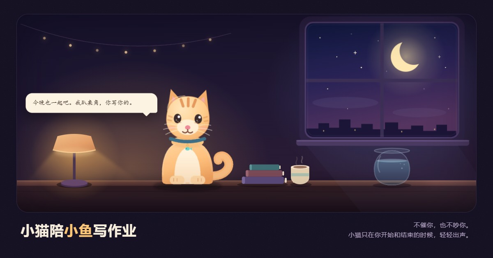

# 小猫陪小鱼写作业

一个给小鱼晚上写作业用的小网站。

小猫趴在桌角，陪着。它不会催，也不会在你写字的时候突然跳出来。只有你按下开始、时间到了、或者一轮写完的时候，它才轻轻出声。

> 小猫的承诺：不催你，不吵你，只在你开始和结束的时候出声。

## 为什么是这样

小猫和小鱼是一对。小猫想陪着，但陪写作业最怕的，是陪着陪着变成了打扰。

所以这里所有的设计都让着「写作业」这件事：

- **开始之后，小猫就趴下。** 闭眼、收尾巴、呼吸变慢，屏幕上多一句「小猫已趴下 · 不打扰」。
- **专注的时候不出现任何对话。** 不说话、不弹窗、不提醒喝水。唯一会动的是时钟和很慢的星星。
- **只在三个时刻出声**：你按下开始、一轮结束、休息结束。声音很轻，也可以在右上角关掉。
- **不想计时也行。** 点「今晚不计时，只让小猫陪着」，小猫就只是一直趴着，没有倒计时。
- **写完可以「今晚收工」。** 小猫把台灯关掉，屋子变成蓝色，只留下今晚写了几轮、鱼缸里一共几条小鱼。想再写一轮，就再开灯。
- **可以摸摸它。** 按住小猫（或者点「摸摸」），它会眯起眼睛、把头往你手上靠，头顶冒心；松手后还会小声说一句。专注的时候摸它，它不会醒，只会在梦里动一下。
- **有三种吃的，随时都能喂。** 猫粮、猫条、罐头：猫粮每天早上补到 3 份，猫条和罐头各补 1 份；每写完一轮再多 1 份猫粮。猫醒着就立刻吃；猫睡着也没关系，把吃的放在桌上，它醒来第一件事就是去吃。没粮的时候它会告诉你明天还会补。
- **它记得你来过。** 每写完一轮，鱼缸里多一条小鱼；连续来的天数、今晚的进度，都收在「小猫的记录」里。

## 里面有什么

- 25 / 15 / 40 分钟专注，5 / 10 分钟休息，结束后自动进入休息倒计时。
- 「今晚收工」：台灯关掉、猫睡下，留一张今晚的收尾；同一晚再打开还是这个状态，第二天自动回到书桌。
- 计时按真实时间走：切到别的 App、锁屏、刷新页面，回来时间还是对的。
- 关掉标签页再打开，会接着刚才那一轮（暂停 / 进行中都能恢复）。
- 「今晚的作业」清单：写一条、勾一条，第二天没写完的会留着，写完的清掉。
- 小猫的记录：连续陪读天数、今晚的小鱼、一共写完的轮数、最近七晚，还有猫粮、猫条、罐头、摸过几次、喂过几次。
- 三种吃的：猫粮每天补到 3 份，猫条、罐头各 1 份；每完成一轮猫粮 +1，喂一次 −1；摸猫不消耗任何东西。
- 猫睡着时喂，吃的会留在桌上，等它醒来再吃；这个状态刷新页面也不会丢。
- 吃猫粮是低头小口吃，吃猫条会伸出舌头舔，吃罐头会多舔一会儿；三种的台词都不一样。
- 小猫的鱼缸：今晚每完成一轮，就游进来一条小鱼。
- 可以改称呼（默认「小鱼」「小猫」），改完就会一直这么叫。
- 手机上可以「添加到主屏幕」，iPhone 上是全屏打开的；断网也能用。专注时如果设备支持，会尽量让屏幕不熄灭。
- 空格键可以开始 / 暂停。

数据只存在这台设备的浏览器里，不会上传到任何地方。换设备、换浏览器，记录不通用。

## 本地打开

```bash
# 任意静态服务器都行，比如：
npx serve .
# 或者
python -m http.server 4173
```

然后打开 `http://localhost:4173`。

直接双击 `index.html` 也能看，但 Service Worker 和「添加到主屏幕」需要 http(s)。

## 部署

已经部署在 GitHub Pages：

**https://aduoer.github.io/xiaoyu-study-cat/**

想改完再发布，只要：

```bash
git add -A
git commit -m "改了一点小猫的话"
git push
```

GitHub Pages 会在一两分钟内自动更新。如果打开还是旧的样子，刷新两次——第一次让后台把新文件取回来，第二次就是新的了。

## 想改的话

| 想改什么 | 改哪里 |
| --- | --- |
| 小猫说的话 | `js/copy.js`，所有台词都在里面，`{fish}` / `{cat}` 会自动换成你们的名字 |
| 「收工」时说的话 | `js/copy.js` 里的 `night` |
| 颜色、夜景色调 | `css/style.css` 顶部的 `:root` 变量 |
| 房间里的东西、猫的样子 | `index.html` 里那段内联 SVG（灯、窗、鱼缸、猫） |
| 默认时长、休息时长 | 页面里点右上角设置；代码里在 `js/store.js` 的 `fresh()` |
| 离线缓存的版本 | `sw.js` 里的 `CACHE` 名字，改完版本号 +1 最稳 |

称呼和时长都可以直接在页面里改，不用动代码。

## 一点技术说明

- 纯静态：HTML + CSS + 原生 ES Module，没有构建步骤，没有第三方依赖，没有网络字体。
- 猫、窗、月亮、台灯、鱼缸都是手写 SVG；星星、呼吸、尾巴、鱼都是 CSS 动画。
- 计时以「结束时间戳」为准，不依赖 `setInterval` 的准确性。
- 提示音是 Web Audio 现场合成的三个音，没有音频文件。
- 尊重系统的「减少动态效果」设置。
- 支持 iOS Safari / Android Chrome / 桌面浏览器。

## 相关

小猫最早出现在 [喵喵捞鱼记](https://aduoer.github.io/neko-fish-game/) 里。这次它从池塘爬回了书桌。

## License

MIT
